# Reference frames

Screenshots taken with mpv from the reference video
([All Evangelion UI / GUI Scenes (+EOE)](https://www.youtube.com/watch?v=k0oQr7ZVtBQ)).
Each entry has a link to the frame, a description of what's on screen and the
recurring UI elements it shows. On-screen text is quoted as written, original
typos included ("ENARGY", "CELEBRUM", "Chech"…).

## Frames

### 001

[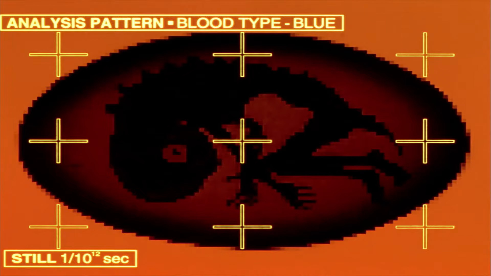](reference/mpv-shot0001.jpg)

Pixelated, low-res scan of an eye shape (an Angel's), dark red on a flat orange
background. A 3×3 grid of thin yellow `+` crosshairs is laid over it. Labels in
outlined boxes: `ANALYSIS PATTERN • BLOOD TYPE - BLUE` top-left,
`STILL 1/10¹² sec` bottom-left.

**Elements:** orange monochrome, crosshair grid, outlined label boxes, pixelated bitmap.

### 002

Full-screen `ALERT` in huge heavy black condensed sans on bright red, with
black/red chevron hazard stripes running above and below.

**Elements:** full-screen alert, chevron hazard band, black-on-red type.

### 003

[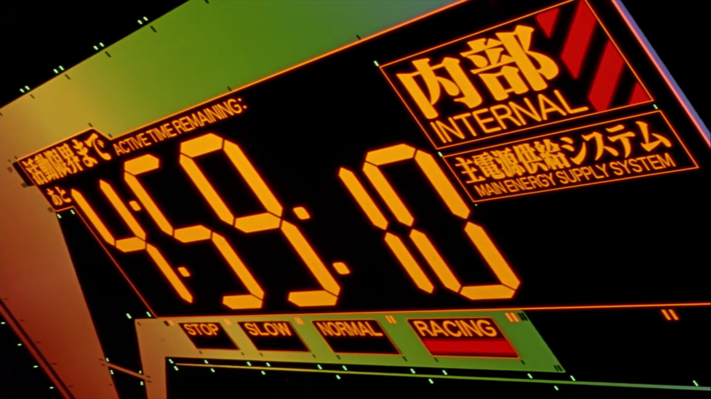](reference/mpv-shot0003.jpg)

Eva internal-battery timer, seen at an angle: a huge orange seven-segment
countdown `4:59:10` on black. `活動限界まで あと / ACTIVE TIME REMAINING:` on the
left, a boxed `内部 INTERNAL` with red/black diagonal hazard stripes, and
`主電源供給システム MAIN ENERGY SUPPLY SYSTEM`. Bottom row of mode lamps:
`STOP` `SLOW` `NORMAL` `RACING` (RACING lit red). The housing bezel has an
orange-to-green gradient.

**Elements:** seven-segment digits, bilingual JP/EN labels, hazard stripes, status lamps, perspective tilt.

### 004

[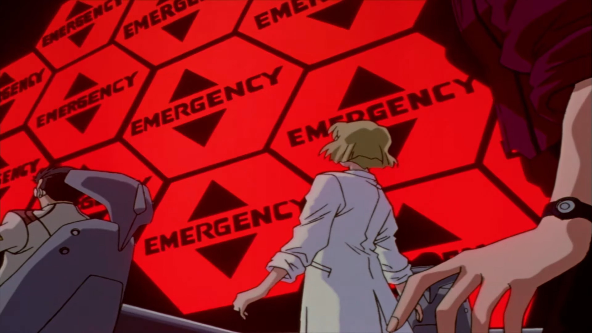](reference/mpv-shot0004.jpg)

Anime scene: Ritsuko and staff in front of a wall of glowing red hexagon
panels, each with a black triangle and the word `EMERGENCY`.

**Elements:** hex tile wall, red glow, triangle warning icon.

### 005

Small red stamp, centred on pure black: `極秘` in heavy Mincho over
`TOP SECRET` in serif, inside a double-ruled red rectangle.

**Elements:** stamp / seal box, Mincho kanji, serif Latin, lots of negative space.

### 006

[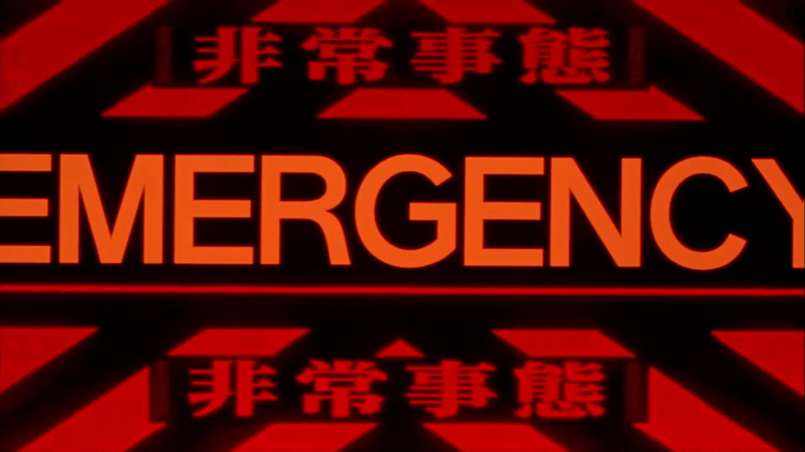](reference/mpv-shot0006.jpg)

`EMERGENCY` in big orange-red condensed sans spanning the whole width and
cropped at both sides. Above and below: `非常事態` in heavy Mincho between
bracket rules, over red/black chevron bands.

**Elements:** full-bleed title, bilingual header/footer, chevron bands.

### 007

[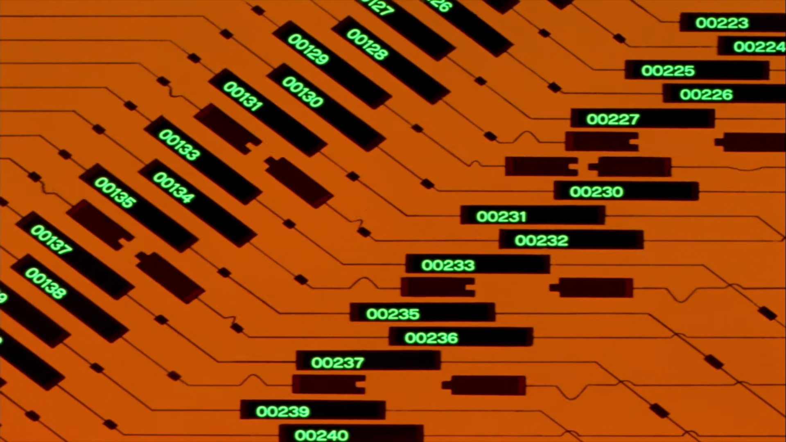](reference/mpv-shot0007.jpg)

Diagonal flow diagram on solid orange: black parallel tracks/lines with
stepped joints and small black tags holding green 5-digit IDs
(`00223` … `00240`), cascading from top-right to bottom-left.

**Elements:** orange background, black routing lines, green numeric tags, diagonal layout.

### 008

[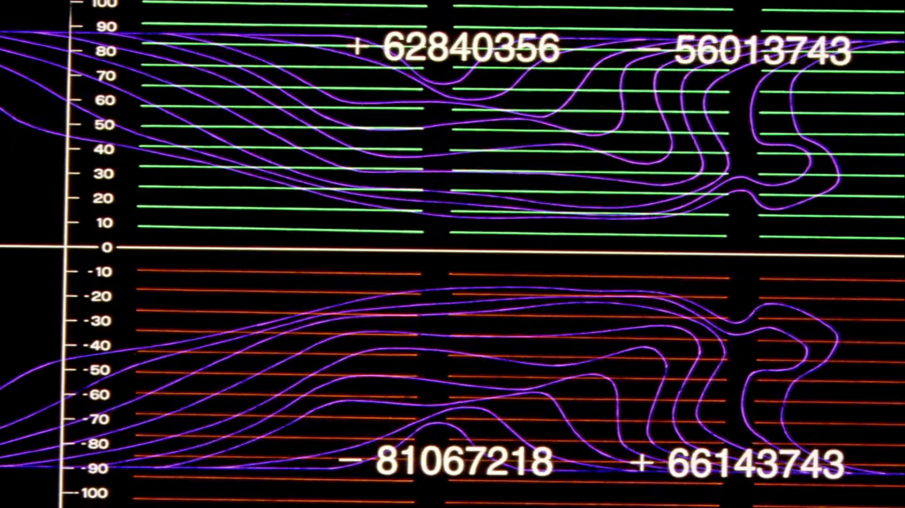](reference/mpv-shot0008.jpg)

Graph on black: vertical axis from `+100` to `-100`, thin horizontal green
(upper half) and red (lower half) grid lines, purple/violet contour-like curves
in both halves. White numeric readouts: `+ 62840356`, `56013743`,
`- 81067218`, `+ 66143743`.

**Elements:** symmetric axis, line chart, purple strokes, large numeric readouts.

### 009

[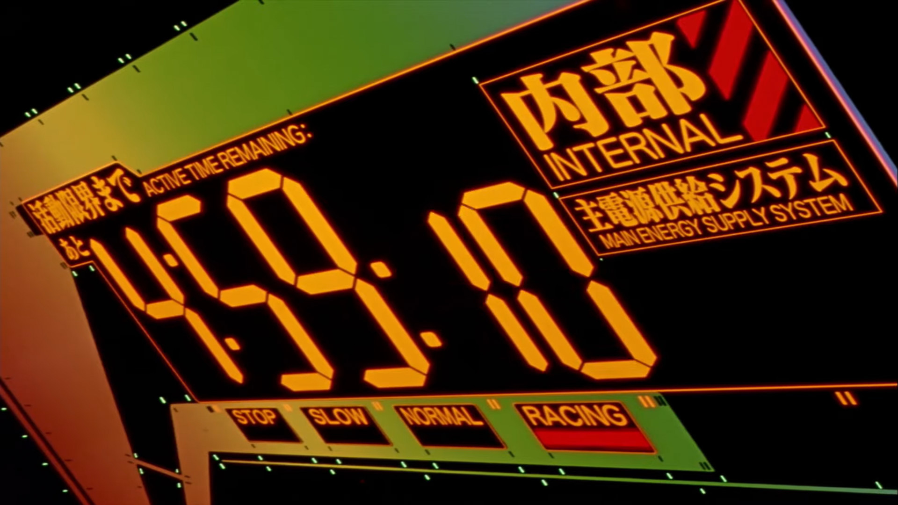](reference/mpv-shot0009.jpg)

Same internal-battery timer as [003](#003), same `4:59:10`, slightly different
framing.

**Elements:** see 003.

### 010

[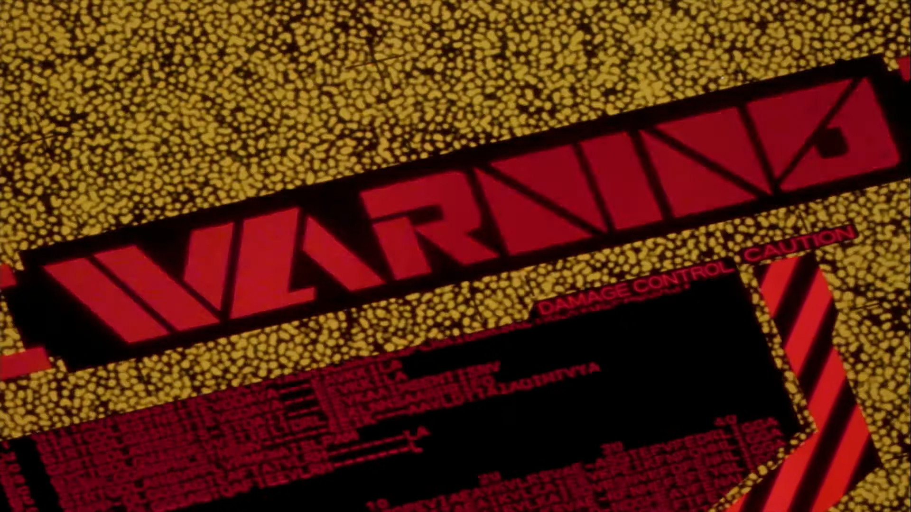](reference/mpv-shot0010.jpg)

`WARNING` in heavy red slanted type, cut by hazard stripes, on a field of
dense yellow/olive dot noise. Small red text underneath (`DAMAGE CONTROL`,
`CAUTION`) and red/black diagonal stripes on the right.

**Elements:** halftone/dot noise texture, slanted title, hazard stripes.

### 011

[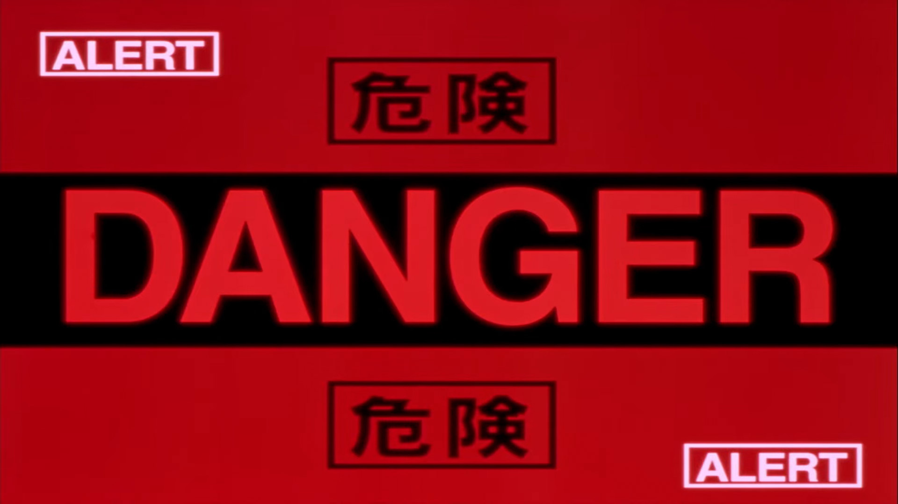](reference/mpv-shot0011.jpg)

Full red screen: `DANGER` in big red condensed sans on a black band across the
middle, `危険` in boxed Mincho above and below, and small white-outlined
`ALERT` tags in the top-left and bottom-right corners.

**Elements:** central black band, bilingual labels, corner tags.

### 012

[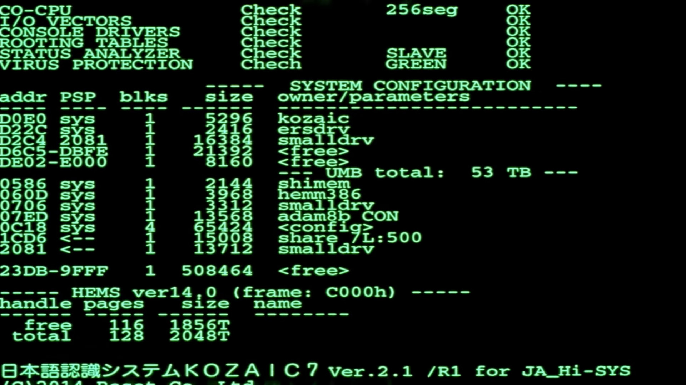](reference/mpv-shot0012.jpg)

Green monospace terminal dump on black: boot checklist (`CO-CPU`,
`I/O VECTORS`, `CONSOLE DRIVERS`, `ROOTING TABLES`, `STATUS ANALYZER`,
`VIRUS PROTECTION` → `Check … OK`), a `SYSTEM CONFIGURATION` table
(`addr PSP blks size owner/parameters`), `UMB total: 53 TB`,
`HEMS ver14.0` and a footer `日本語認識システムKOZAIC7 Ver.2.1 /R1 for JA_Hi-SYS`.

**Elements:** DOS-style monospace terminal, tabular columns, phosphor green.

### 013

[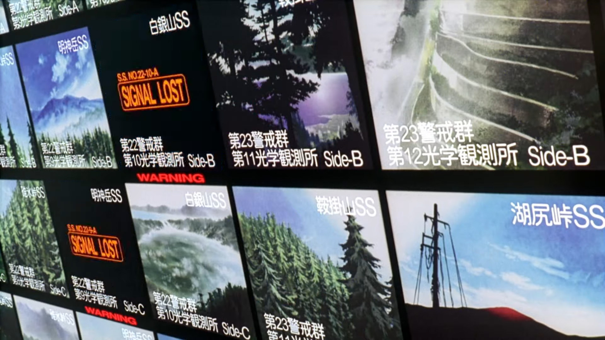](reference/mpv-shot0013.jpg)

Perspective wall of monitors showing landscape feeds (mountains, forest, power
line). Each one has a white Japanese label (`第23警戒群 第12光学観測所 Side-B`,
`湖尻峠SS`, `白銀山SS`…), and some show a red `SIGNAL LOST` box and a red
`WARNING`.

**Elements:** video grid, Japanese captions, red status overlays.

### 014

[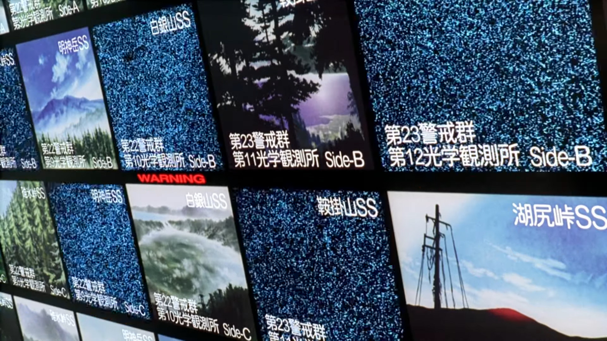](reference/mpv-shot0014.jpg)

Same monitor wall as [013](#013) a moment later: several feeds have turned into
blue/cyan TV static.

**Elements:** static/noise effect, signal-loss transition.

### 015

[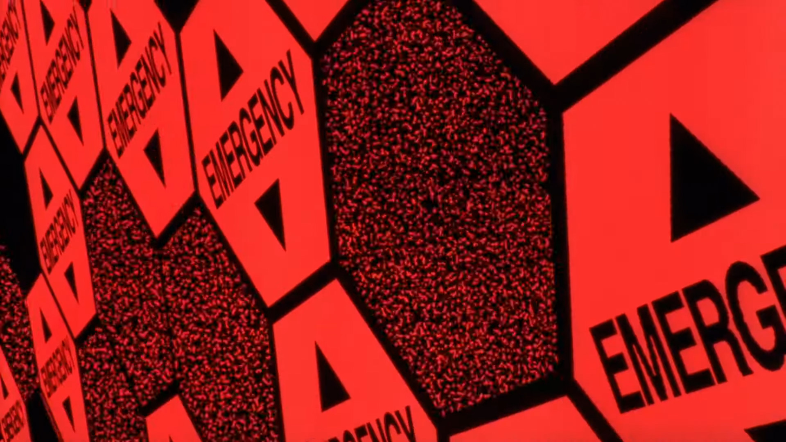](reference/mpv-shot0015.jpg)

Close-up of the red `EMERGENCY` hex panels from [004](#004), tilted: some
hexagons are filled with red noise texture, others hold a black triangle and
the word `EMERGENCY` set diagonally.

**Elements:** hex tiles, noise fill, rotated type.

### 016

[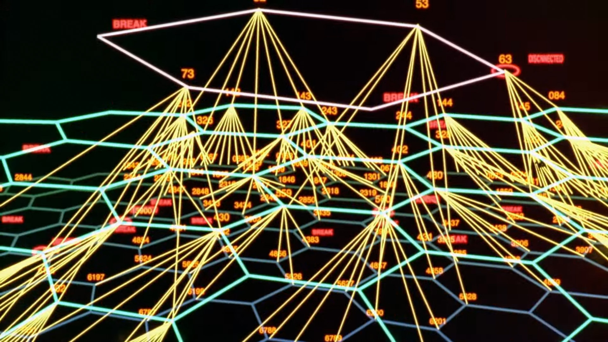](reference/mpv-shot0016.jpg)

3D perspective network map: cyan hex grid floor with orange node labels
(numbers, `BREAK`). Yellow lines fan out from a white hexagon outline floating
above the grid.

**Elements:** perspective hex grid, node graph, cyan + orange + yellow.

### 017

[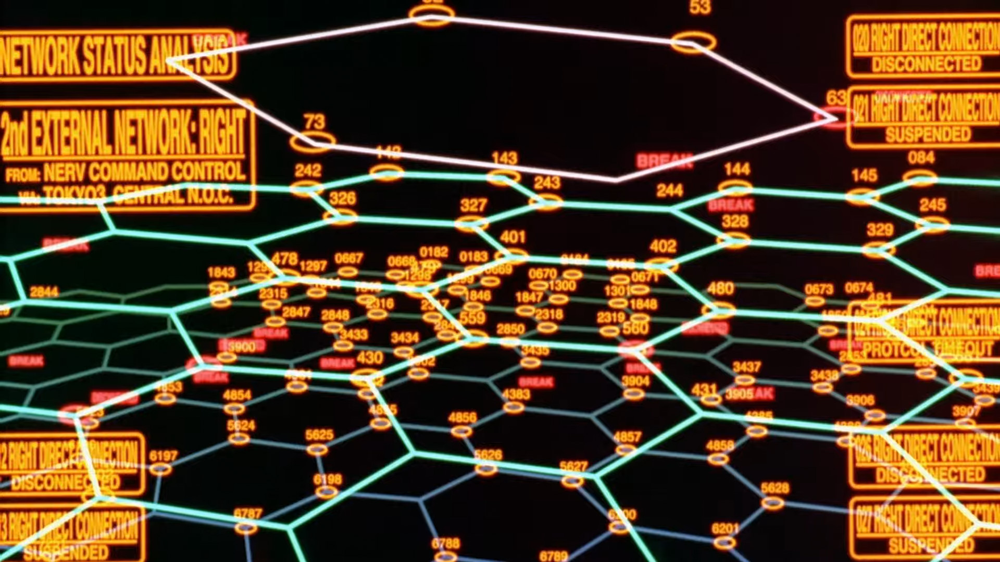](reference/mpv-shot0017.jpg)

Same network as [016](#016) with orange labels: `NETWORK STATUS ANALYSIS`,
`2nd EXTERNAL NETWORK: RIGHT`, `FROM: NERV COMMAND CONTROL`,
`TO: TOKYO3 CENTRAL N.O.C.`. Orange circles mark nodes, and right-side boxes
say `DISCONNECTED` / `SUSPENDED`.

**Elements:** boxed orange labels, node circles, status list.

### 018

[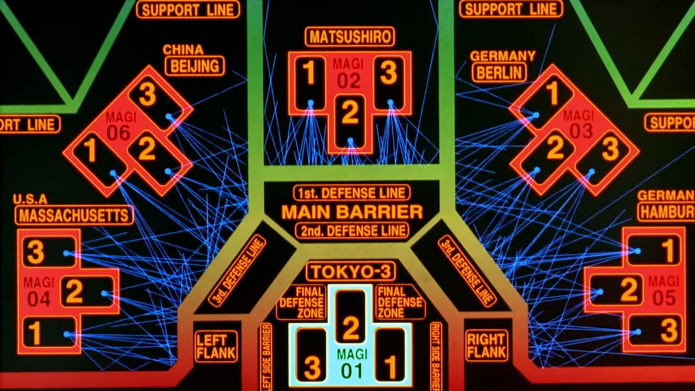](reference/mpv-shot0018.jpg)

MAGI defense map: a symmetric schematic with a green outline. Red diamond
groups numbered `1 2 3` stand for the MAGI copies (`MAGI 01` … `MAGI 06`)
and are labelled by city (`MATSUSHIRO`, `CHINA BEIJING`, `GERMANY BERLIN`,
`U.S.A MASSACHUSETTS`, `GERMANY HAMBURG`). Centre: `TOKYO-3`,
`1st. DEFENSE LINE`, `MAIN BARRIER`, `2nd. DEFENSE LINE`,
`FINAL DEFENSE ZONE`, `LEFT/RIGHT FLANK`, `SUPPORT LINE`. Blue lines show
hacking intrusions.

**Elements:** schematic diagram, numbered diamonds, outlined labels, red/green/blue.

### 019

[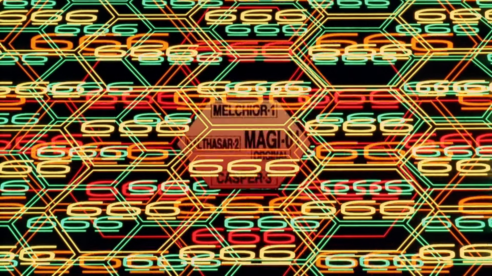](reference/mpv-shot0019.jpg)

Dense layered pattern of orange, red and green `666`-like glyph chains over a
hex lattice, with a central hexagon `MELCHIOR-1` / `BALTHASAR-2` /
`MAGI-01` / `CASPER-3` (MAGI under hacking attack).

**Elements:** repeated glyph pattern, hex lattice, layered colours.

### 020

[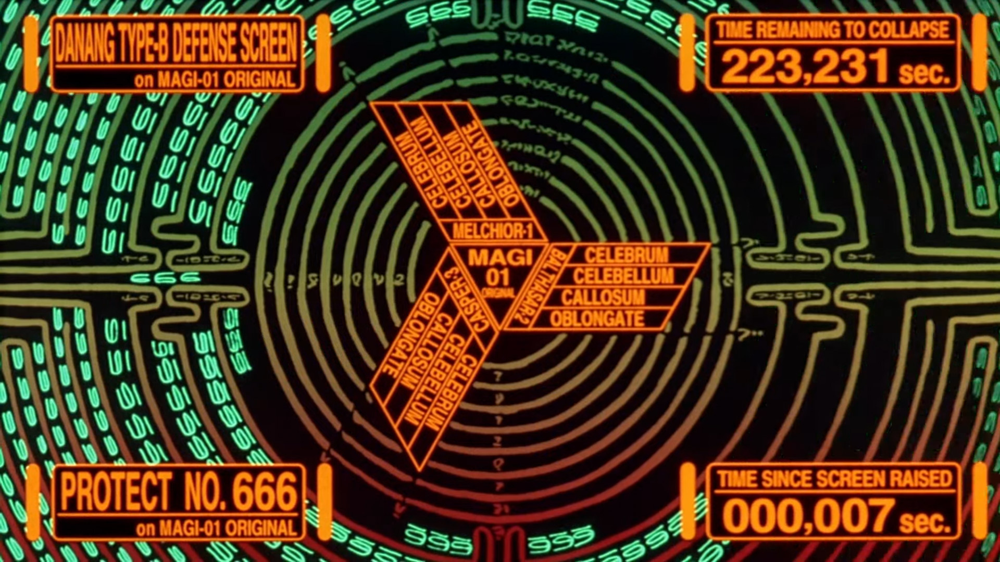](reference/mpv-shot0020.jpg)

Concentric green circuit rings around a three-armed orange MAGI emblem
(`MAGI 01`, `MELCHIOR-1`, `CELEBRUM`, `CELEBELLUM`, `CALLOSUM`, `OBLONGATE`).
Corner boxes: `DANANG TYPE-B DEFENSE SCREEN on MAGI-01 ORIGINAL`,
`TIME REMAINING TO COLLAPSE 223,231 sec.`, `PROTECT NO.666`,
`TIME SINCE SCREEN RAISED 000,007 sec.`

**Elements:** radial/concentric layout, corner info boxes, Y-shaped emblem.

### 021

[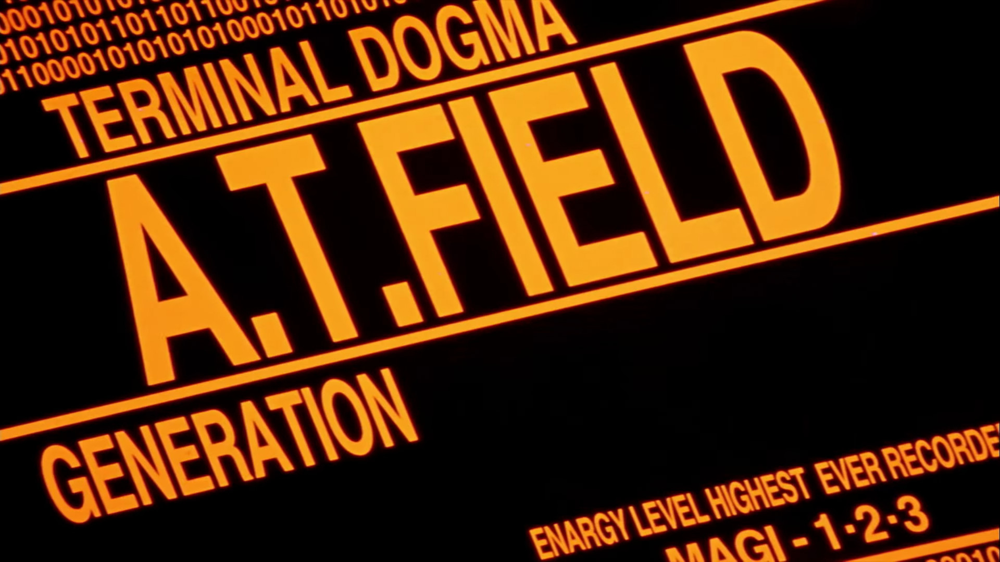](reference/mpv-shot0021.jpg)

Big skewed orange title `A.T.FIELD` between orange rules, with
`TERMINAL DOGMA` above and `GENERATION` below, and
`ENARGY LEVEL HIGHEST EVER RECORDED` / `MAGI-1·2·3` in small text. Binary
`0101…` strings run along the edges.

**Elements:** rotated title block, rules, binary filler text.

### 022

[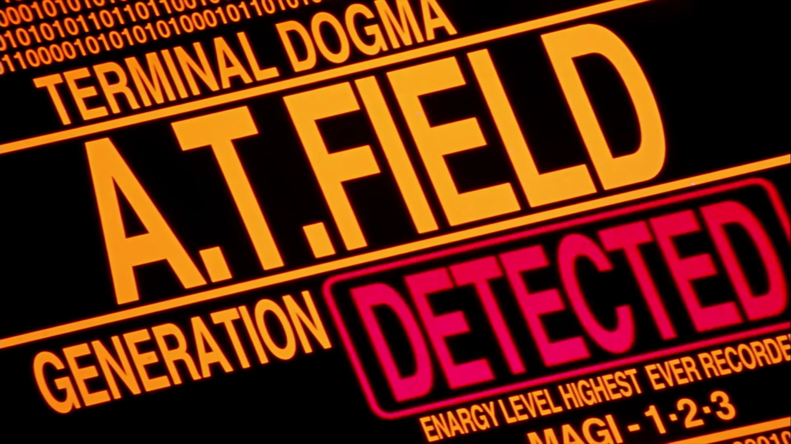](reference/mpv-shot0022.jpg)

Same as [021](#021) with a magenta/pink rounded-rect `DETECTED` stamp added
over the bottom-right.

**Elements:** overlaid status stamp, magenta accent.

### 023

[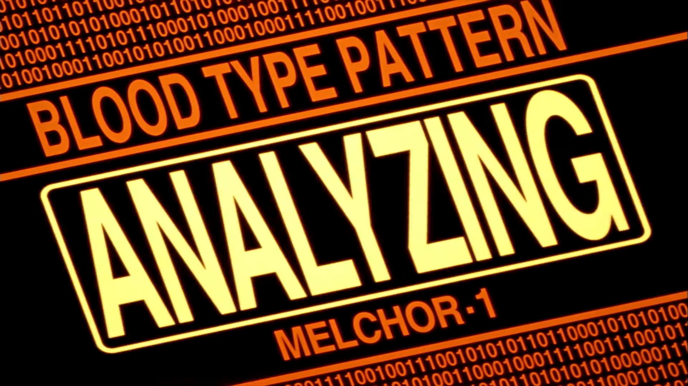](reference/mpv-shot0023.jpg)

`BLOOD TYPE PATTERN` in orange, with a large pale-yellow `ANALYZING` inside an
outlined rounded rectangle and `MELCHOR·1` below, skewed, with binary strings
along the rules.

**Elements:** skewed title, rounded outlined box, pale yellow highlight.

### 024

[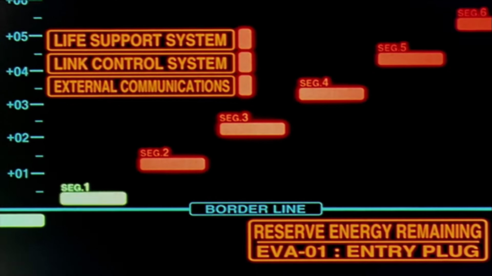](reference/mpv-shot0024.jpg)

Stepped bar chart on black: left axis from `+01` to `+05`, orange/red bars
`SEG.1` … `SEG.6` climbing in steps above a cyan `BORDER LINE`. Top-left
boxed list: `LIFE SUPPORT SYSTEM`, `LINK CONTROL SYSTEM`,
`EXTERNAL COMMUNICATIONS`. Bottom-right: `RESERVE ENERGY REMAINING`,
`EVA-01 : ENTRY PLUG`.

**Elements:** step chart, threshold line, boxed list, glow.

### 025

[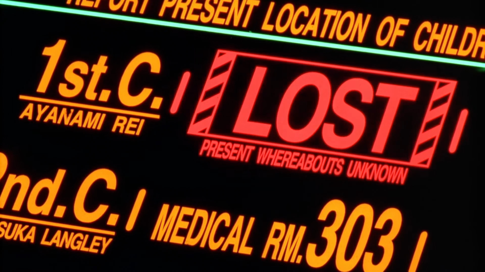](reference/mpv-shot0025.jpg)

Tilted pilot-location board: `REPORT PRESENT LOCATION OF CHILDREN` across the
top under a cyan line. `1st.C. AYANAMI REI` next to a red hazard-striped
`LOST` box (`PRESENT WHEREABOUTS UNKNOWN`), and
`2nd.C. ASUKA LANGLEY` next to `MEDICAL RM.303`.

**Elements:** list rows, hazard-striped status box, big orange numerals.

### 026

[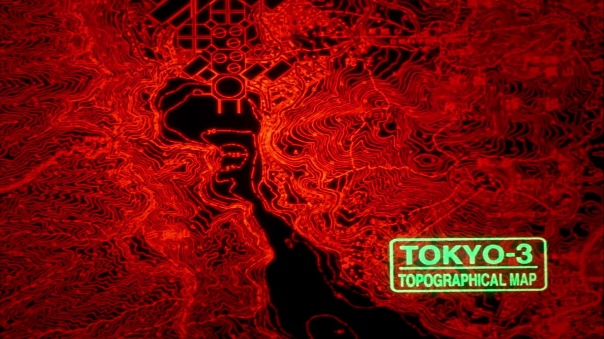](reference/mpv-shot0026.jpg)

Red topographic contour map of Tokyo-3 on black, with a green outlined label
`TOKYO-3 TOPOGRAPHICAL MAP`.

**Elements:** contour lines, single-hue map, outlined label.

### 027

[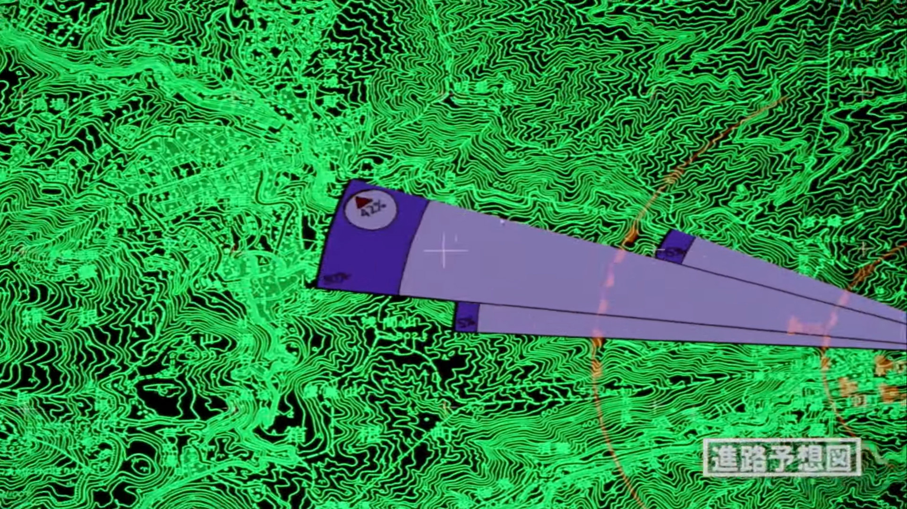](reference/mpv-shot0027.jpg)

Green topographic contour map with a purple 3D projectile/shape crossing it,
and a dashed orange trajectory. Small Japanese label `進路予想図` (predicted
path) bottom-right.

**Elements:** contour map, 3D overlay, trajectory line.

### 028

[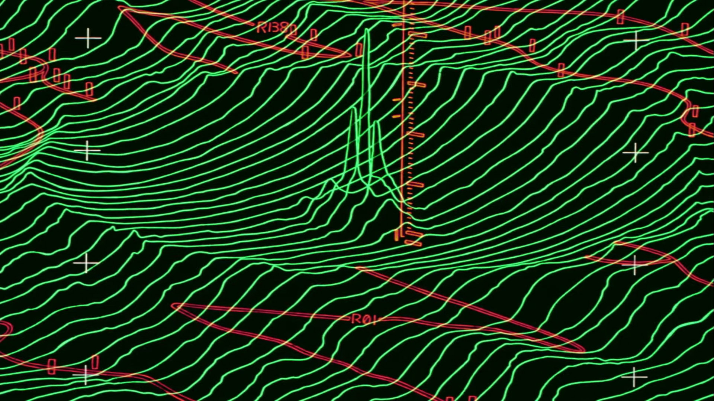](reference/mpv-shot0028.jpg)

Close-up of a green contour terrain in perspective with a sharp green spike,
red outlines and labels, and white `+` markers.

**Elements:** perspective contour lines, red highlight paths, crosshairs.

### 029

[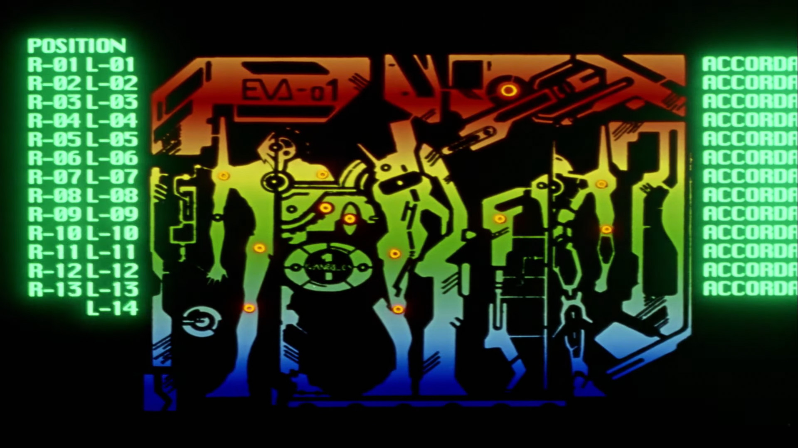](reference/mpv-shot0029.jpg)

EVA-01 schematic filled with a vertical rainbow gradient (red → yellow → green
→ blue), between glowing green monospace lists: `POSITION R-01 L-01 …` on the
left and `ACCORDANCE` repeated on the right.

**Elements:** rainbow gradient fill, glowing green lists, silhouette.

### 030

[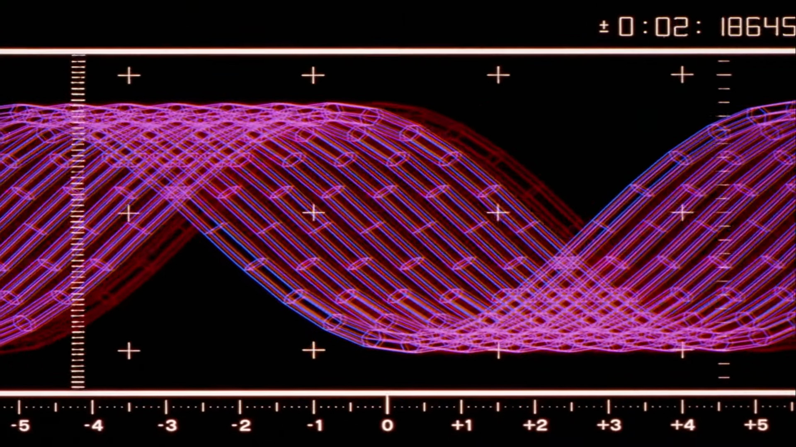](reference/mpv-shot0030.jpg)

Sine-wave bundle on black: dozens of magenta/purple/blue sinusoids crossing,
with a `+` grid, a ruler from `-5` to `+5` at the bottom and a timecode
`±0:02:18645` top-right.

**Elements:** many-line waveform, ruler axis, timecode.

### 031

[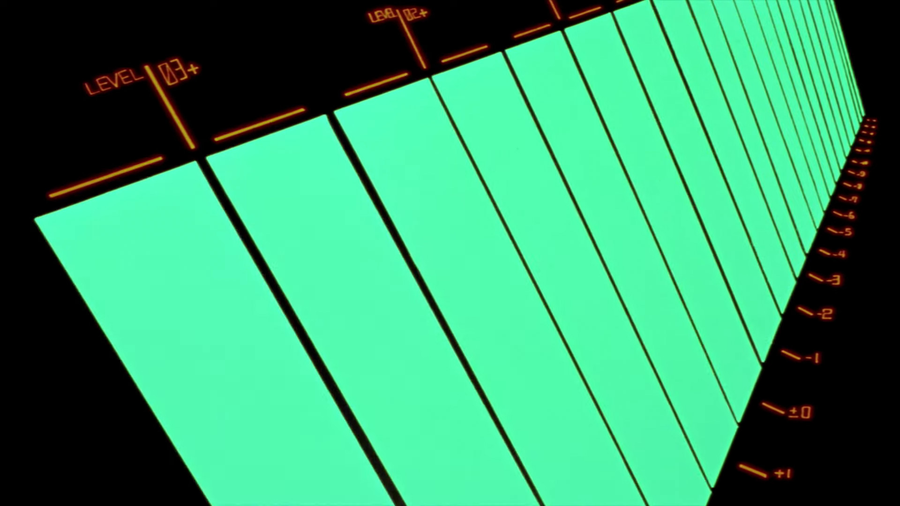](reference/mpv-shot0031.jpg)

Perspective row of tall mint-green bars stretching to the right, with an
orange `LEVEL 03+` marker and a tick scale going down the right side.

**Elements:** 3D bar gauge, mint fill, orange ticks.

### 032

[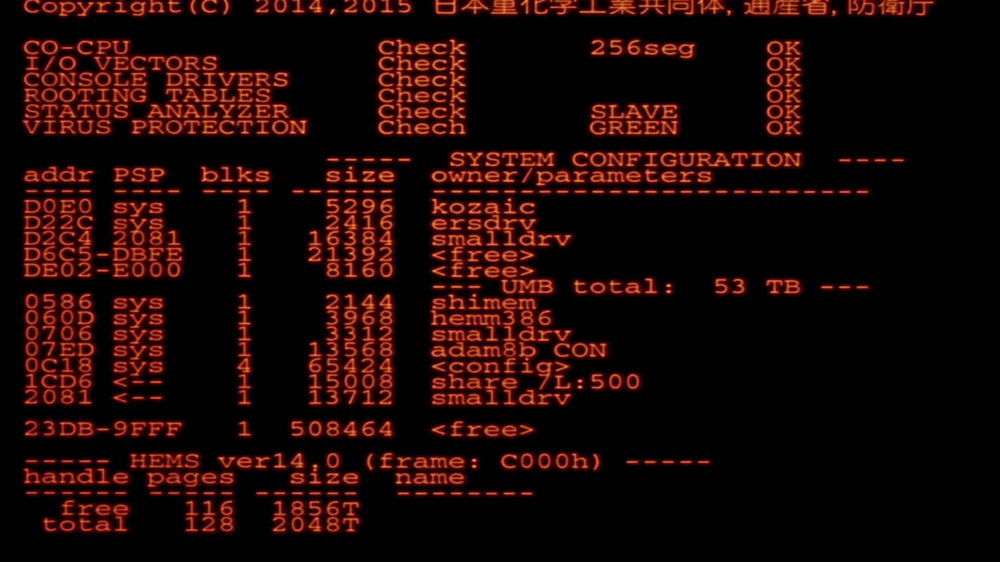](reference/mpv-shot0032.jpg)

Same terminal dump as [012](#012), in red/orange instead of green, with a
`Copyright(C) 2014,2015 …` header in Japanese.

**Elements:** monospace terminal, red phosphor variant.

### 033

[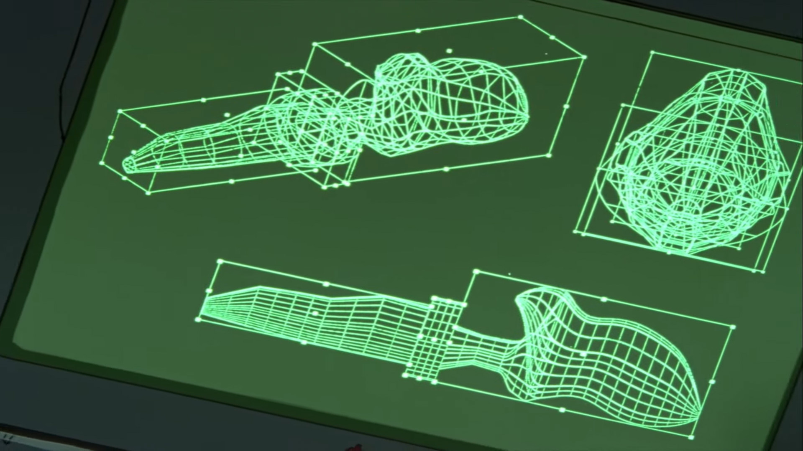](reference/mpv-shot0033.jpg)

Physical monitor (anime scene) with pale green wireframe meshes of anatomical
shapes, each inside a 3D bounding box, on a dark green screen.

**Elements:** wireframe mesh, bounding boxes, monochrome green CRT.

### 034

[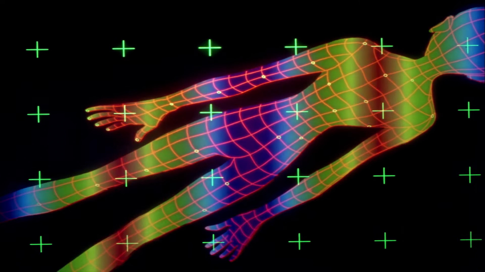](reference/mpv-shot0034.jpg)

Human body (lying, arms out) drawn as a wireframe mesh with rainbow-gradient
surface colours, on black with a green `+` grid.

**Elements:** wireframe body, rainbow gradient, crosshair grid.

### 035

[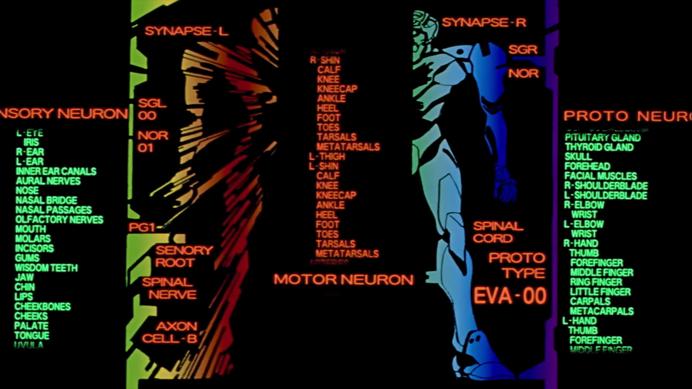](reference/mpv-shot0035.jpg)

Nervous-system mapping: two Eva silhouettes in rainbow gradient
(`SYNAPSE-L`, `SYNAPSE-R`) with long green body-part lists (`SENSORY NEURON`,
`MOTOR NEURON`, `PROTO NEURON`, `SPINAL CORD`, `AXON CELL-B`,
`PROTO TYPE EVA-00`).

**Elements:** columns of small text, gradient silhouettes, labels.

### 036

[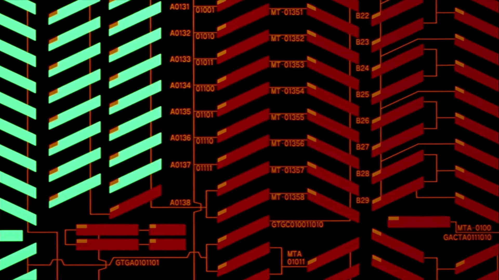](reference/mpv-shot0036.jpg)

Parallel diagonal bars: mint-green on the left, dark red on the right, with
tiny labels (`A0131`, `MT-01351`, `B22`, `GTGC0101…`) and orthogonal routing
lines at the bottom.

**Elements:** diagonal stripe blocks, two-colour split, small codes.

### 037

[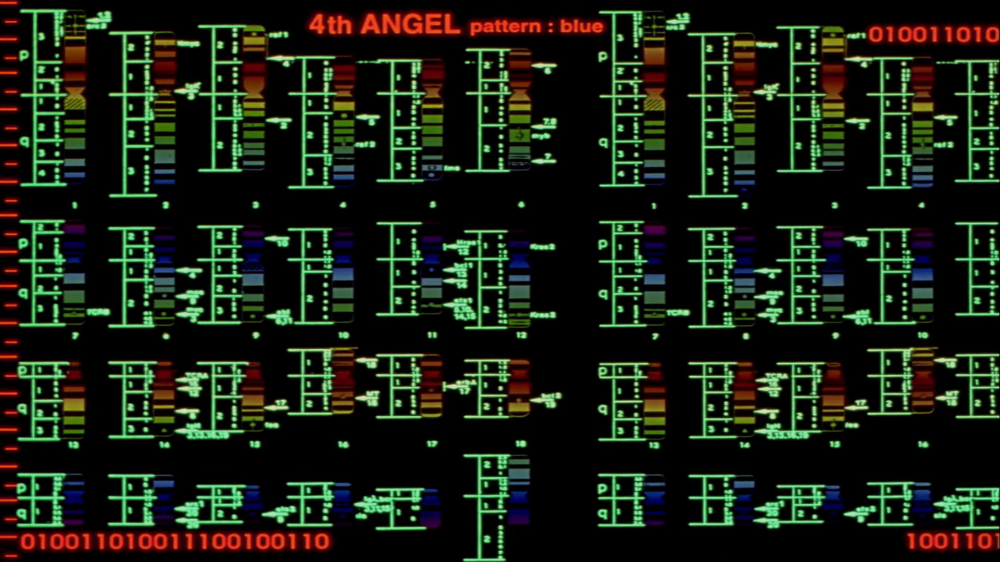](reference/mpv-shot0037.jpg)

`4th ANGEL pattern : blue` in red at the top. A grid of green circuit/DNA-like
glyph blocks with coloured accents, and binary strings in red at the top and
bottom.

**Elements:** repeated glyph matrix, binary text, green + red.

### 038

[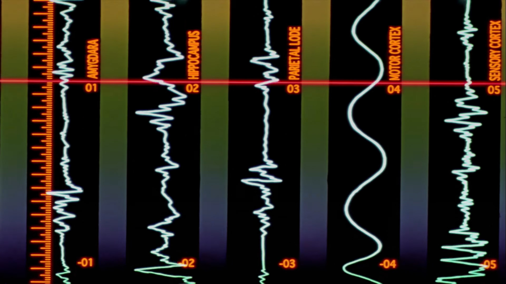](reference/mpv-shot0038.jpg)

Five vertical brainwave channels (`AMYGDALA`, `HIPPOCAMPUS`, `PARIETAL LOBE`,
`MOTOR CORTEX`, `SENSORY CORTEX`): pale cyan waveforms over olive/purple
gradient columns, a red horizontal baseline and a ruler on the left.

**Elements:** vertical waveform lanes, gradient columns, rotated labels.

### 039

[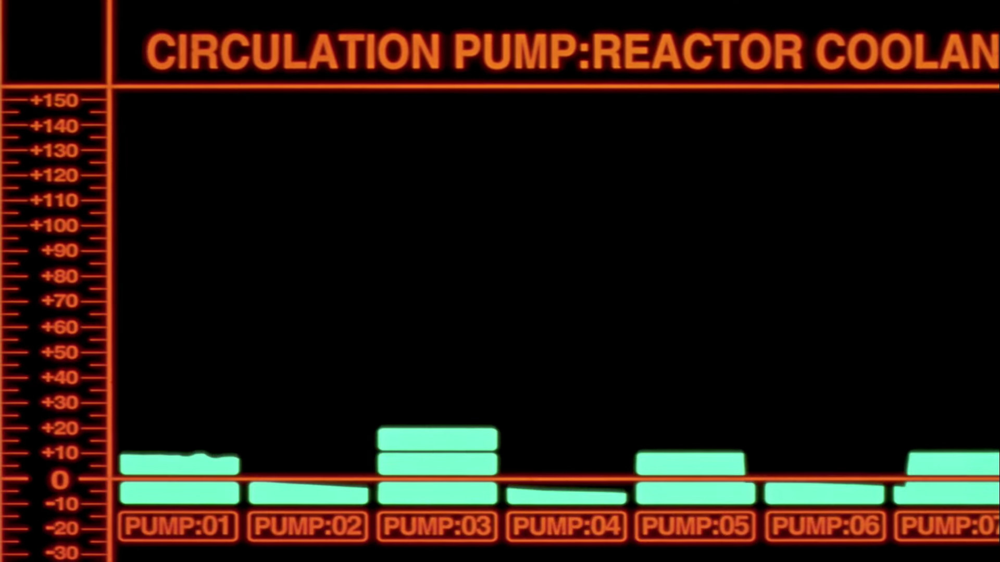](reference/mpv-shot0039.jpg)

`CIRCULATION PUMP:REACTOR COOLANT` in orange. A bar chart with a `-30` to
`+150` scale, mint bars around the zero line and orange-boxed labels
`PUMP:01` … `PUMP:07`.

**Elements:** bar chart, boxed axis labels, mint + orange.

### 040

[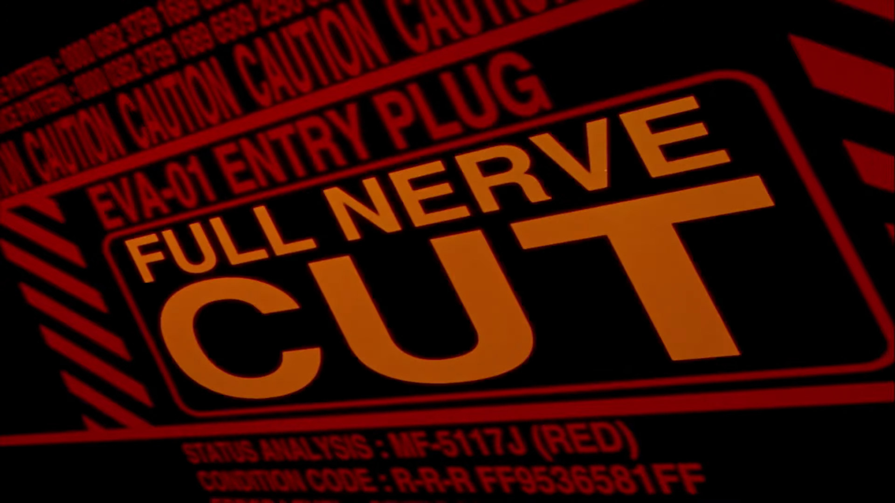](reference/mpv-shot0040.jpg)

Skewed red panel: `FULL NERVE CUT` in big orange inside an outlined box,
`EVA-01 ENTRY PLUG` and repeated `CAUTION` above, hazard stripes, and
`STATUS ANALYSIS : MF-5117J (RED)` / `CONDITION CODE : …` in small text.

**Elements:** skewed title box, repeated caution text, hazard stripes.

### 041

[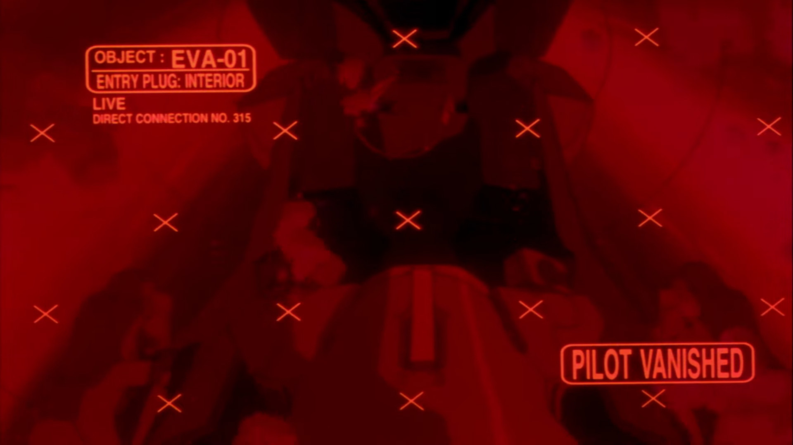](reference/mpv-shot0041.jpg)

Dark red, blurry entry-plug interior with a grid of small `×` markers. Labels:
`OBJECT : EVA-01 / ENTRY PLUG: INTERIOR`, `LIVE`,
`DIRECT CONNECTION NO. 315`, and `PILOT VANISHED` bottom-right.

**Elements:** × marker grid, outlined labels over footage, red monochrome.

### 042

`REFUSED` in huge red condensed type, heavily skewed and cropped, with dark red
stripes.

**Elements:** full-bleed skewed title, red-on-red.

### 043

[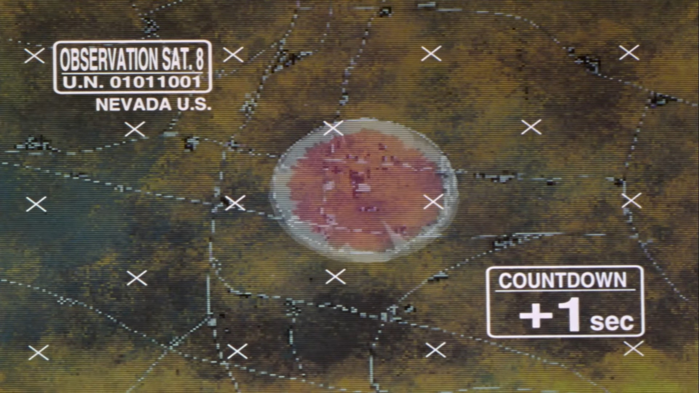](reference/mpv-shot0043.jpg)

Satellite photo (brown/olive terrain) with a reddish circular crater/target and
a grid of white `×` markers. White-outlined labels:
`OBSERVATION SAT. 8 / U.N. 01011001 / NEVADA U.S.` and
`COUNTDOWN +1 sec`.

**Elements:** photo with overlay, × grid, white outlined labels.

### 044

[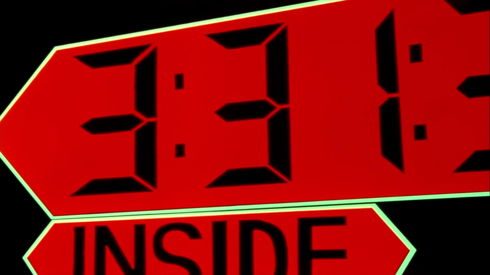](reference/mpv-shot0044.jpg)

Huge black seven-segment digits `3:3…` on a red hexagonal plate with a mint
outline, and `INSIDE` on a second plate below.

**Elements:** seven-segment, elongated hexagon plates, mint stroke.

### 045

[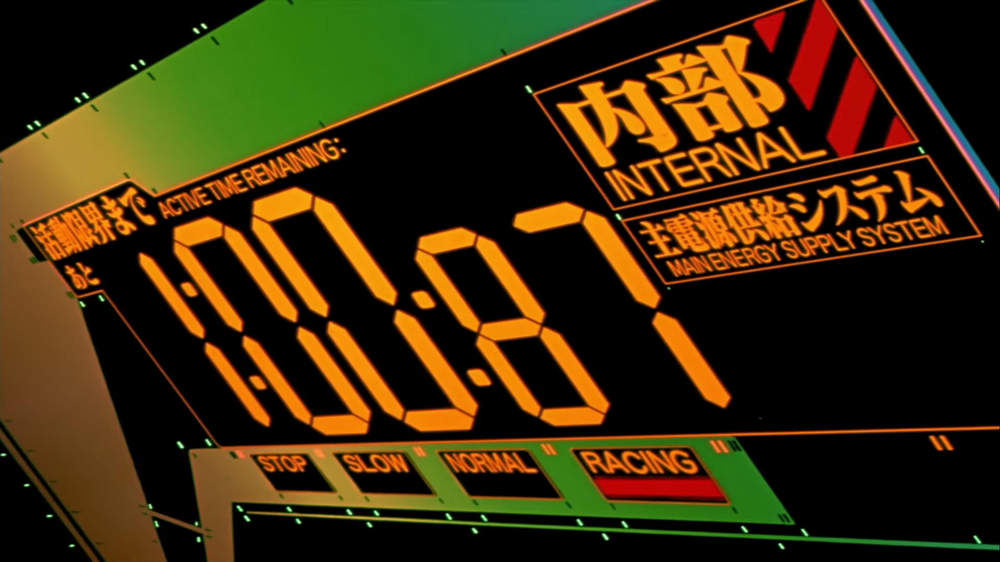](reference/mpv-shot0045.jpg)

Internal-battery timer again (see [003](#003)), now reading `1:00:87`.

**Elements:** see 003.

### 046

[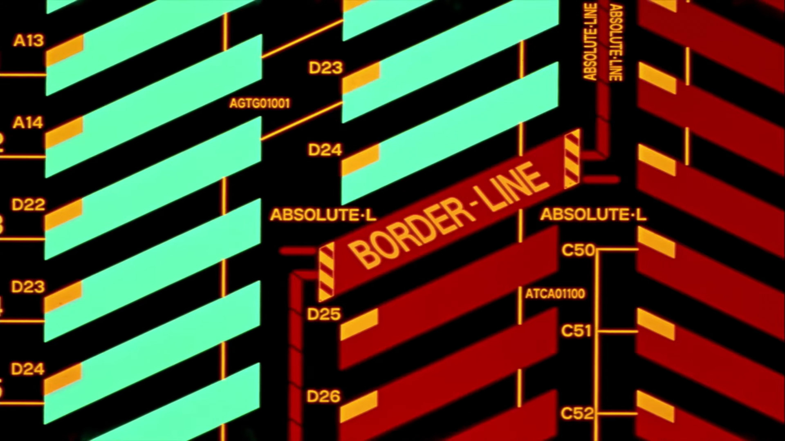](reference/mpv-shot0046.jpg)

Diagonal mint and dark red bars with orange end-caps and labels (`A13`,
`D23`, `ABSOLUTE-L`, `C50`…). A hazard-striped orange `BORDER-LINE` tag runs
diagonally between them.

**Elements:** diagonal bars, hazard tag, orange codes.

### 047

[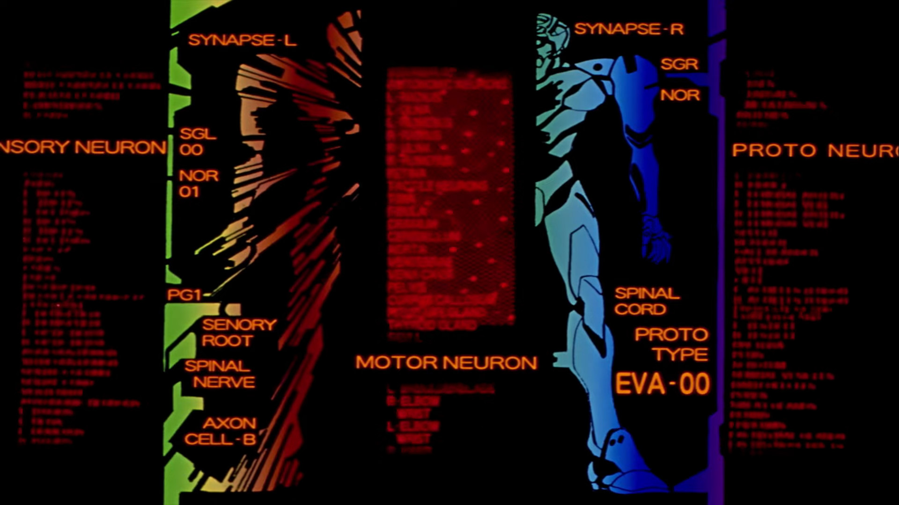](reference/mpv-shot0047.jpg)

Variant of [035](#035), the nervous-system mapping, with red text lists
instead of green.

**Elements:** see 035.

### 048

[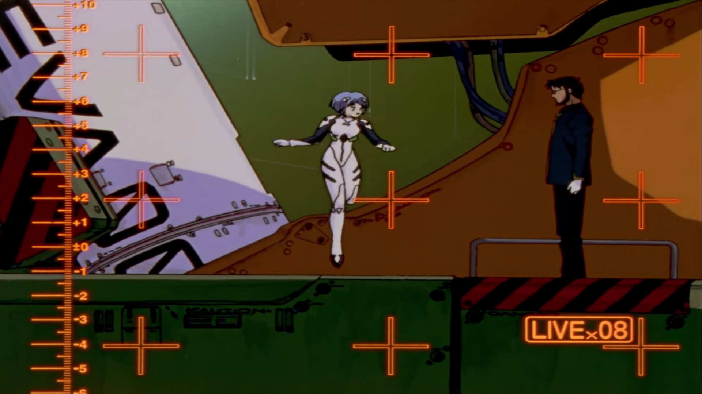](reference/mpv-shot0048.jpg)

Anime scene (Rei in plugsuit and Gendo) seen through a camera overlay: orange
`+` crosshairs, a vertical ruler on the left (`+8` … `-6`) and a `LIVE×08`
label.

**Elements:** camera HUD overlay, ruler, crosshairs.

### 049

[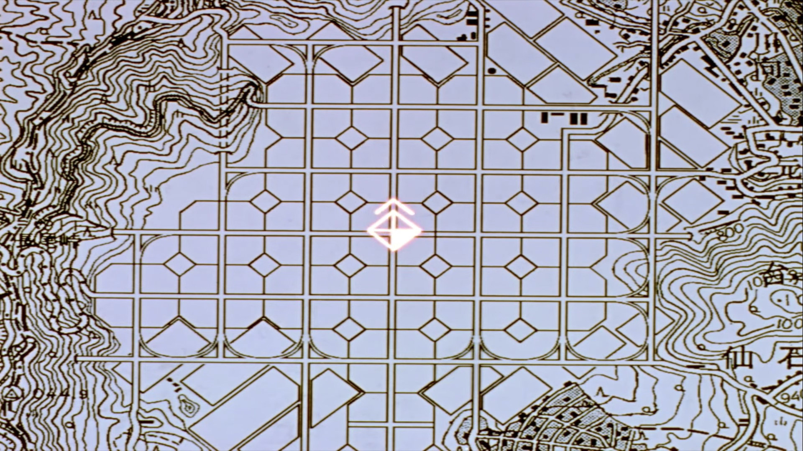](reference/mpv-shot0049.jpg)

Pale blue/white city map: street grid with diamonds at the intersections,
brown contour lines, Japanese place names and a white target marker.

**Elements:** light map variant, diamond intersections, target marker.

### 050

[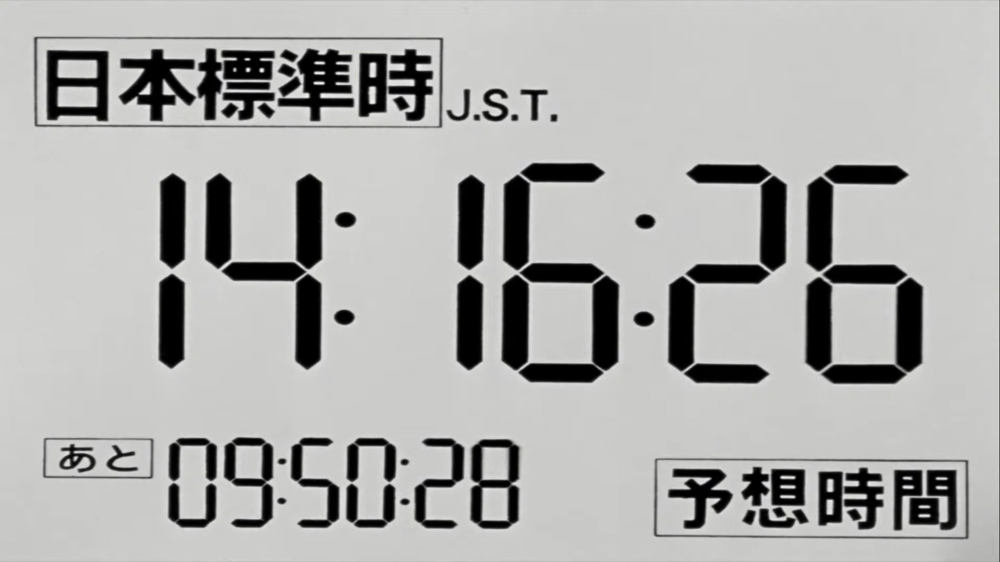](reference/mpv-shot0050.jpg)

Light grey clock panel: `日本標準時 J.S.T.` in a box, a large black
seven-segment `14:16:26`, `あと 09:50:28` and a boxed `予想時間`
(estimated time).

**Elements:** light-mode panel, seven-segment, boxed JP labels.

### 051

[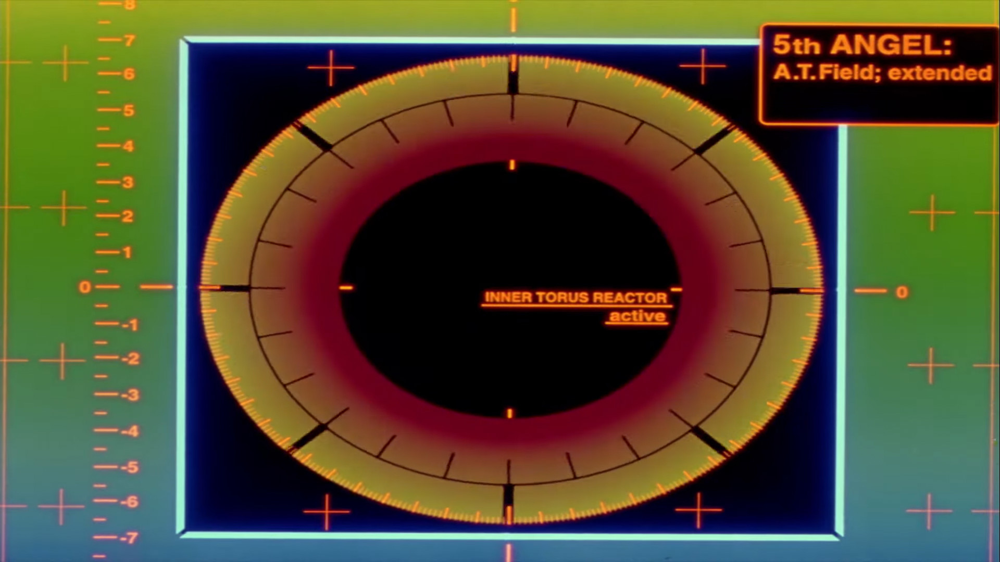](reference/mpv-shot0051.jpg)

Inner torus reactor view: concentric ring going yellow → red → black at the
centre, framed by a cyan rectangle on a green/yellow field with orange rulers
and crosshairs. Labels `5th ANGEL: A.T.Field; extended`,
`INNER TORUS REACTOR active`.

**Elements:** radial gradient ring, framed viewport, side rulers.

### 052

[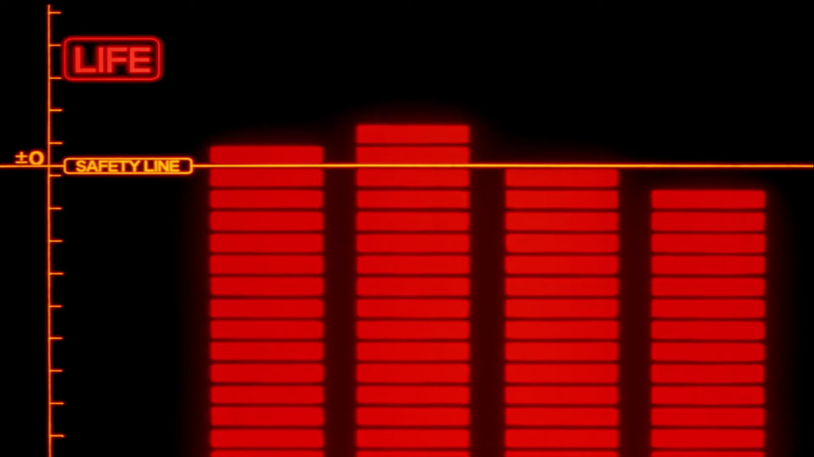](reference/mpv-shot0052.jpg)

`LIFE` in a red outlined box. A bar chart of glowing red segmented bars around
a `±0 SAFETY LINE`, with an orange axis on the left.

**Elements:** segmented bars, threshold line, red glow.

### 053

[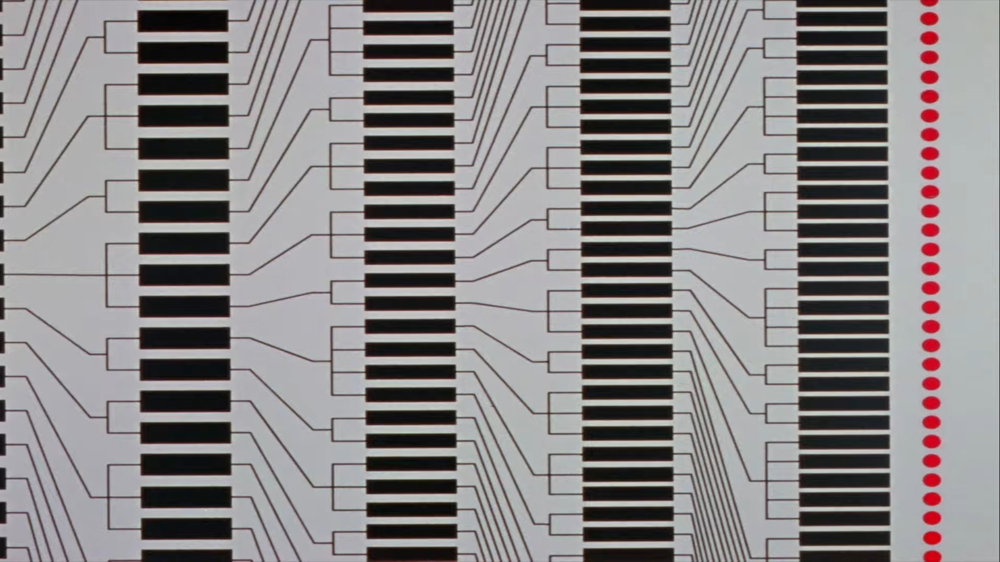](reference/mpv-shot0053.jpg)

Light grey background with black bar columns (piano-key/barcode-like) joined by
thin branching lines, and a red dotted line on the right.

**Elements:** light-mode, bar matrix, tree connectors.

### 054

Eva cockpit targeting screen: blue sky view through the cockpit frame, with a
red wireframe octahedron (Ramiel), a white triangular reticle,
`MODE: SHOOT` and coordinate readouts (`T:`, `S:`, `X:`, `Y:`, `Z:`) in red.

**Elements:** targeting reticle, wireframe shape, readout list.

### 055

Green satellite map with dense road network, a noisy circular blob and many
small orange label boxes. Top-right: `NERV SATELLITE PHOTO`.

**Elements:** green map, orange tag swarm.

### 056

Two faces (Shinji, and a character with glasses) overlaid with pale green and
brown topographic contours and Japanese place names.

**Elements:** contour overlay on footage, double exposure.

### 057

`J.A. FUEL BUNDLE`: a large honeycomb of mint hex cells over a radial/grid
background with a rainbow gradient strip. A few red cells at the bottom.
Orange label column on the right (`SPACER`, `FUEL PELLET`, `PENCIL`,
`PRESSURE`, `CONTROL R…`, `END CAP`, `END PLATE`) and a numeric scale on the
left.

**Elements:** hex cell fill (state per cell), side label list, polar grid.

### 058

MAGI voting panel: `提訴` and `決議` headers in orange Mincho, `CODE : 132`,
`FILE:MAGI_SYS`, `EXTENTION:2048`, `EX_MODE:ON`, `PRIORITY:A___`. Mint
tilted cards `CASPER 3` and `MELCHIOR 1` around an orange `MAGI` ellipse, an
empty black box (Balthasar), and `審議中` (deliberating) in red.

**Elements:** MAGI three-panel layout, mint cards, double rules, kanji headers.

### 059

Same `J.A. FUEL BUNDLE` as [057](#057), now mostly red cells with only a few
mint ones at the top (meltdown progressing).

**Elements:** hex cell state change.

### 060

`PSYCHIC ESSENCE THRESHOLD SIGNAL`, `EVA-01 ENTRY PLUG CURRENTLY RECEIVING`,
`OBJECT: THIRD C. (SHINJI IKARI)`. Bordered table `DIRECT LINK 122` …
`SUB-LINK 605`, `ACTIVE LINKS`, and a red blobby pulse texture panel with
`OBJECT IMAGE FIXATION PULSE: 2`.

**Elements:** data table in box, organic texture panel, orange labels.

### 061

Three columns of horizontal bars `PHASE 04` … `PHASE 13`: mint for phases
04–07, red for 08–13, with orange vertical markers.

**Elements:** status bar matrix, two-state colours.

### 062

Dark red screen with blocky, glitchy red circuitry. `INTRUDER TRACE PATH` box,
rows of small orange digits, and orange timers `22:58:67` / `16:09:41`
bottom-right.

**Elements:** glitch/blocky texture, number rows, timers.

### 063

Bright green topographic contour map on black with Japanese place names
(Hakone area).

**Elements:** contour map, green monochrome.

### 064

`ENERGY OBSERVATIONAL DATA`: a stepped 3D area chart, green going to cyan, with
orange segmented ramps. Footer boxes: `HIGH LEVEL ENERGY FIELD APPROACHING`,
`GENERATING POINT: TERMINAL DOGMA : POINT 00`, `OBSERVED BY MAGI`, and
`RADIOACTIVITY: NEGATIVE`.

**Elements:** 3D step area chart, footer label bar.

### 065

`GENETIC PATTERN: COMPARED with KNOWN DATA`: a dense matrix of small
glyph blocks shading from blue/cyan to red/green, an orange horizontal line
and a `+40` to `-40` axis.

**Elements:** colour-banded glyph matrix, axis.

### 066

`PSYCHOGRAPHIC DISPLAY Phase 4 LINK A⁰`: an orange curve rising into a dense
scribble loop, with `EVA-01 PILOT : SHINJI IKARI`,
`DATA ANALYZED BY CASPER`, a green `+` grid and an axis from `-10` to `+110`.

**Elements:** scribble line plot, green crosshair grid, orange stroke.

### 067

Two orange folder-shaped panels side by side: `A.D.2000` / `A.D.2015`,
`MULTINOMINAL ANALYSIS`, `STORED DATA` / `REALTIME DATA`,
`PHYSICAL PHENOMENON`, `DIMENSIONAL DISTORTION`, filled with columns of
faint data.

**Elements:** tabbed folder shapes, solid orange panels, comparison layout.

### 068

Silhouettes of the bridge staff in front of a big screen: a yellow-line
pattern graph inside a frame on a green contour background. Orange boxes:
`ANALYSIS (According to MAGI): WAVELENGTH BLOOD TYPE : BLUE`.

**Elements:** big-screen context, framed sub-panel.

### 069

Perspective bar gauge (like [031](#031)) with a green → blue gradient across
the bars, labels `EVA-02 MAIN SYNCHRO GRAPH-1` and a `LEVEL` marker.

**Elements:** 3D bar gauge, gradient across bars.

### 070

Teal/cyan line map of Yokohama on black, with orange top-down ship silhouettes
and orange labels (`DDG-173 KONGO`, `CGN-021 GMCN-Kirov`). White box
`作戦行動予定図 OPERATING SCHEMATIC`.

**Elements:** line-art map, tactical unit icons, white outlined label.

### 071

Bridge scene (Misato and staff) under a large screen: black sky with green
`+` grid, red trajectory arcs, `EAST INDIAN OCEAN SEGMENT SATELLITE TRAJECTORY:`,
`OBJECT` and `OBSERVATION SAT.6` markers.

**Elements:** trajectory arcs, crosshair grid, red outlined labels.

### 072

Dark navy hex mesh with a cluster of glowing red hexes (contamination).
`シグマユニット D-17 第87タンパク壁`, `SCANNER : No.8766`, and arrow tags
`to PRIBNOW BOX` / `to CENTRAL DOGMA` at the bottom.

**Elements:** hex mesh heatmap, arrow tags, bilingual labels.

### 073

Red-to-blue gradient hex mesh with dark contamination spots. Orange boxes
`SIGMA UNIT D-17 87th PROTEIN WALL`, `SIGMA UNIT D-18 6th ULTRAPURE WATER TUBE`
and `POLLUTED AREA ALERT`.

**Elements:** hex mesh, gradient background, orange label boxes.

### 074

Same hex mesh with `SIGMA UNIT D-16/17/18` tags, a blue pentagon outline
`PRIBNOW BOX` holding `DUMMY 1/2/3`, and a white `POLLUTED AREA ALERT` box.

**Elements:** pentagon outline, nested labels, white alert box.

### 075

`11th ANGEL PATTERN : BLOOD TYPE BLUE`: a rainbow (red → yellow → green → blue)
tangle of filaments on black, with a ruler from `-3` to `+3` at the top and
bottom and a `10⁻⁶m` scale bar.

**Elements:** rainbow filaments, symmetric rulers, scale bar.

### 076

Sunset over the sea (footage tinted orange) inside an octagonal orange
viewfinder with rulers and crosshairs. `OBJECT: 13th ANGEL`, `x05` zoom.

**Elements:** viewfinder frame, rulers, zoom label.

### 077

Green program structure diagram: vertical columns (`MAIN`, `I/Osys`,
`LOGICsys`, `CIsys`, `X-prog`) filled with tiny function names and joined by
lines.

**Elements:** block diagram, green monospace, connector lines.

### 078

Physical control panel (anime scene) with an orange glowing label
`L.C.L PLANT: CL3 SEG.` / `…RECOGNIZING SYSTEM` / `LOCKED` /
`WAITING FOR PERMISSION KEY`, and a small orange `EMERGENCY` plate.

**Elements:** glowing label on hardware, big status word.

### 079

`EVANGELION HARMONICS SIMULATION GRAPH DISPLAY` box, `TEST PLUG 1`,
`SYNCHRONIZATION TEST NO. 132`, `SUBJECT: SHINJI IKARI`. A green cross-shaped
axis (`-10` … `+10` horizontal, `+A` … `-3` vertical) and a boxed
`SYNCHRO PATTERN GREEN`.

**Elements:** cross axis with ticks, outlined title box, mostly empty black.

### 080

Close-up `MENTAL TOXICITY LE…`: rounded vertical bars labelled `+16` … `+23`,
pink/crimson on the left, mint on the right, between orange tick rulers.

**Elements:** rounded pill bars, pink vs mint, rulers.

### 081

`PSYCHOGRAPHIC DISPLAY Phase 4 S.A.LANGLEY : EVA-02 PILOT`: horizontal lines
`LINK A¹` … `LINK A¹⁰` bending down into one point, then a yellow scribble
tangle, with a `±0` axis at the bottom.

**Elements:** converging lines, scribble plot, yellow on black.

### 082

Tilted armor-plate board: green/olive diagonal bands labelled
`PARTITION No. 17/18/19` with big numbers (red and mint),
`ARMOR PLATE PROTECTION LEVEL`, a red outlined `DAMAGED CONDITION:RED`, a red
`ALERT` and a column of red chevrons pointing down.

**Elements:** diagonal bands, big numerals, chevron column, status stamps.

### 083

`MENTAL TOXICITY LEVEL`, `ELAPSED TIME: 120 min.`,
`L.C.L. PURITY : 99.9999989%`. Three rows `SUBJECT 00 FIRST C` /
`01 THIRD C` / `02 SECOND C`, each a horizontal run of thin bars shading from
teal to blue/purple, against a `-100.0` … `+15.0` scale with `CAUTION` and
`DANGER` marks.

**Elements:** segmented bar meters, threshold markers, big red numerals.

### 084

Red blobby/cellular texture filling the screen. `PSYCHIC ESSENCE THRESHOLD SIGNAL`,
`from TARGET IMAGE FIXATION SYSTEM to EVA-01 ENTRY PLUG`, a green boxed
`STATUS: ALL GREEN`, a right-side axis and `LIBIDO` / `DESTRUDO` tags.

**Elements:** organic texture, green status box, faint axis.

### 085

Variant of [038](#038): six brainwave lanes, bright green waveforms over
blue/green/olive columns.

**Elements:** see 038.

### 086

Entry-plug interior (orange/brown footage) with white outlined labels
`OBJECT : EVA-01 / ENTRY PLUG: INTERIOR`, `LIVE`,
`DIRECT CONNECTION NO. 316`, white `+`/`×` markers, corner brackets and
`PILOT VANISHED`.

**Elements:** white HUD variant, corner brackets.

### 087

Hand holding a navy PDA/ID device with yellow-green LCD text: `RITSUKO AKAGI`,
`AGE: 23`, `SEX: F`, `GEHIRN TECHNOLOGY DEPT. SECTION 1`,
`PROJECT-E PLANNING GROUP`, ID numbers, `SEC. LEVEL: AAA`.

**Elements:** LCD-style profile card.

### 088

Staircase chart: diagonal stepped bands in yellow → orange → pink → magenta →
blue on black, with a `+8` … `-2` red axis. Red boxes
`ENTRY PLUG : EVA-01 EMERGENCY DIRECTION SYSTEM`, `REFUSED`, and two
`DISCONNECT`.

**Elements:** stepped gradient bands, red glowing boxes.

### 089

Asuka in the plug (blue-tinted footage) with orange glowing boxes:
`HARMONICS TEST MODE : FIERY DIRECT IMAGE SIZE : 3600dpi SCREEN : HALF TONE`
and a name plate `SORYU ASUKA LANGLEY` with codes.

**Elements:** orange HUD boxes over footage, name plate.

### 090

Earth from orbit (blue) with a grid of white `×` markers and an orange streak.
`OBJECT: 15th ANGEL`, plus a white box
`REALTIME DISPLAY 050X MAGNIFICATION THERMOGRAPHIC FILTER from SURVEILLANCE SATELLITE #08`.

**Elements:** × grid, white outlined info box.

### 091

Hand on a yellow/red/black triangular tiled panel (anime scene). Each triangle
holds text: `TOP UPPER MIDDLE LOWER BOTTOM`, `MAIN SHAFT LEVEL 3 BLOCK-C`,
`SIDE-10`, `CAPTURED`, `DEFENDING`.

**Elements:** triangle tessellation, three-colour tiling, rotated text.

### 092

Blue medical monitor: light blue ECG-like traces on dark navy, big numbers
`.92`, `.97`, `.56`, `.04`, tick scale `-02` … `-09`, small text at the bottom.

**Elements:** monitor traces, blue CRT variant.

## Recurring patterns

| Pattern                                                 | Frames                                                                                                              |
| ------------------------------------------------------- | ------------------------------------------------------------------------------------------------------------------- |
| Full-screen alert words                                 | [002](#002), [006](#006), [010](#010), [011](#011), [042](#042)                                                     |
| Skewed title block                                      | [021](#021), [022](#022), [023](#023), [040](#040), [042](#042), [082](#082)                                        |
| Seven-segment timers                                    | [003](#003), [009](#009), [044](#044), [045](#045), [050](#050)                                                     |
| Hazard / chevron stripes                                | [002](#002), [003](#003), [006](#006), [010](#010), [025](#025), [040](#040), [046](#046), [082](#082)              |
| Hexagon grids / tiles                                   | [004](#004), [015](#015), [016](#016), [019](#019), [057](#057), [059](#059), [072](#072), [073](#073), [074](#074) |
| MAGI layout                                             | [018](#018), [019](#019), [020](#020), [058](#058)                                                                  |
| Bar meters / gauges                                     | [024](#024), [031](#031), [039](#039), [052](#052), [061](#061), [069](#069), [080](#080), [083](#083)              |
| Waveforms / line charts                                 | [008](#008), [030](#030), [038](#038), [066](#066), [081](#081), [085](#085), [092](#092)                           |
| Contour / topographic maps                              | [026](#026), [027](#027), [028](#028), [055](#055), [056](#056), [063](#063), [070](#070)                           |
| Terminal / monospace dumps                              | [012](#012), [032](#032), [077](#077)                                                                               |
| HUD overlay on footage (`+`/`×` grids, outlined labels) | [041](#041), [043](#043), [048](#048), [076](#076), [086](#086), [089](#089), [090](#090)                           |
| Rainbow gradient fills                                  | [029](#029), [034](#034), [035](#035), [075](#075), [088](#088)                                                     |
| Light-mode panels                                       | [049](#049), [050](#050), [053](#053)                                                                               |
